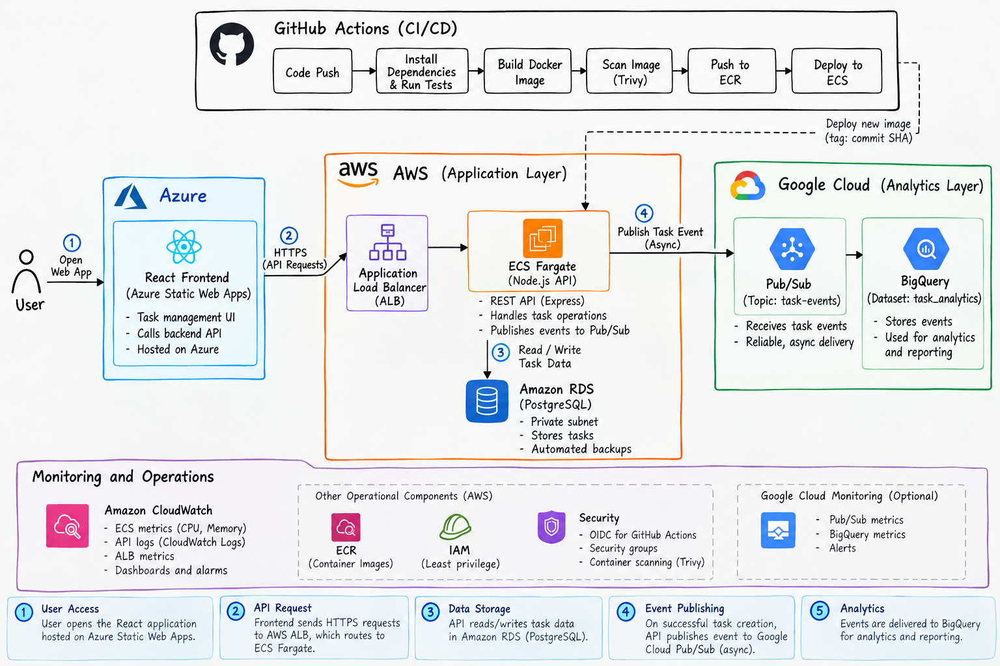
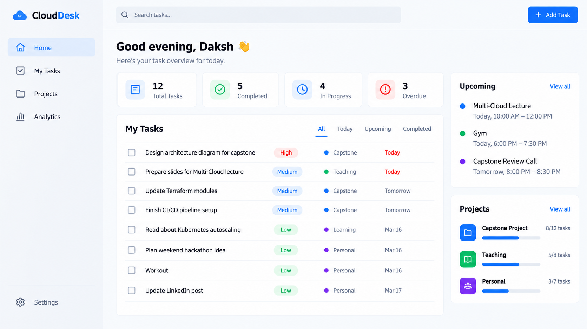
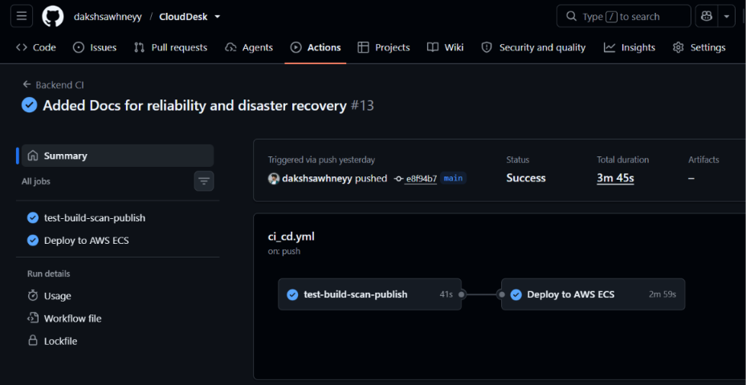
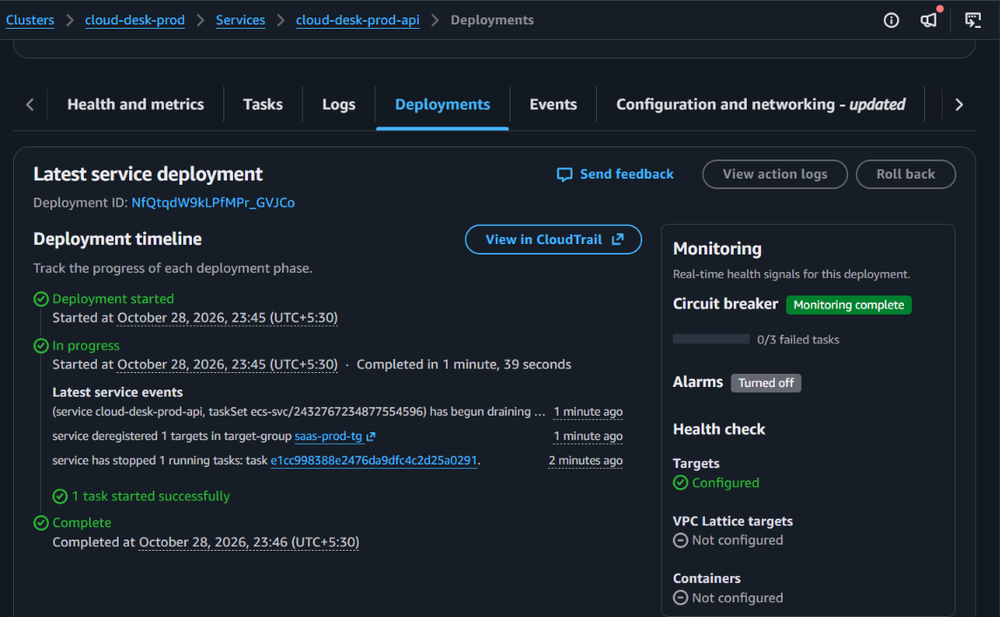
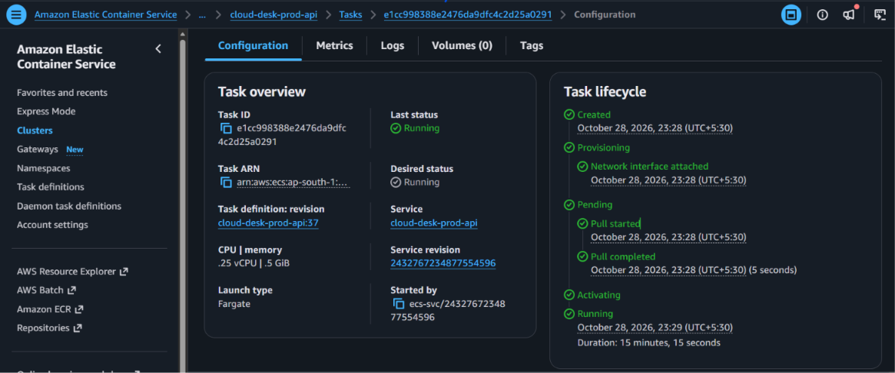
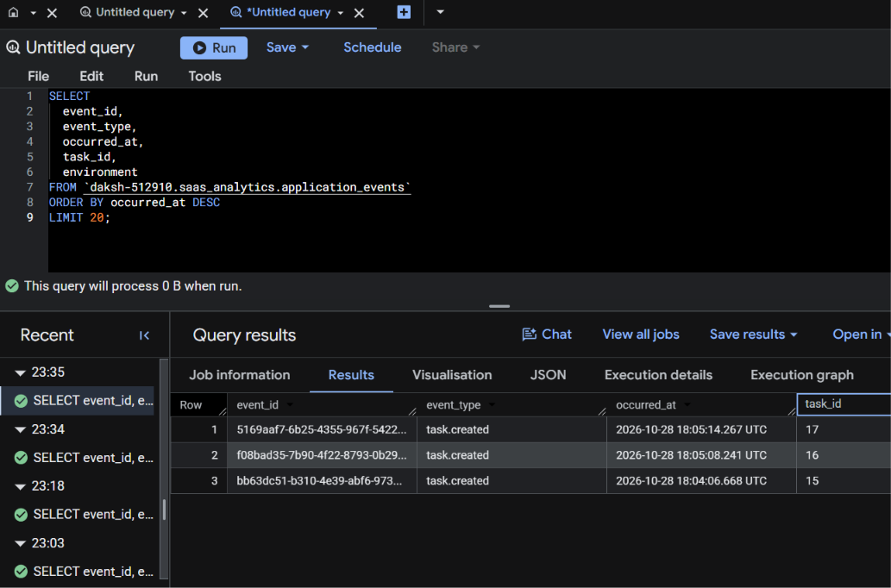

# Multi-Cloud SaaS Platform

**Automated Delivery, Observability, and Event-Driven Analytics**

A task-management SaaS application built to explore how application development, cloud infrastructure, deployment automation, and operational reliability fit together across AWS, Azure, and Google Cloud.

## Overview

This project combines a React frontend, a Node.js API, a relational database, and an asynchronous analytics pipeline into a multi-cloud application platform.

The frontend is hosted on Azure Static Web Apps. The API runs on Amazon ECS Fargate behind an Application Load Balancer, with task data stored in private Amazon RDS for PostgreSQL. Application events are sent to Google Cloud Pub/Sub for delivery to BigQuery.

Terraform manages cloud infrastructure, while GitHub Actions automates application testing, container image publishing, and deployment. The platform also includes monitoring, security controls, and recovery procedures.

The focus is not just deploying an application. It is understanding how to build, release, observe, and recover a cloud-hosted service.

## Platform at a Glance

| Area | Technology |
|---|---|
| Frontend | React, Azure Static Web Apps |
| API | Node.js, Express |
| Container platform | Docker, Amazon ECS Fargate |
| Load balancing | AWS Application Load Balancer |
| Database | Amazon RDS for PostgreSQL |
| Analytics messaging | Google Cloud Pub/Sub |
| Analytics storage | Google BigQuery |
| Infrastructure as code | Terraform |
| CI/CD | GitHub Actions |
| Container registry | Amazon ECR |
| Monitoring and alerting | Amazon CloudWatch, Google Cloud monitoring tools |
| Security | IAM, GitHub Actions OIDC, workload identity federation, container scanning |

## Architecture

<!-- Add your architecture diagram at docs/images/architecture.png -->



*Figure 1. High-level architecture showing the frontend, application API, database, analytics pipeline, and delivery workflow.*

### How the platform works

**1. User requests**

The user interacts with the React application hosted on Azure Static Web Apps. The frontend sends API requests to the AWS Application Load Balancer, which routes traffic to the ECS-hosted Express API.

**2. Application and data**

The API handles task operations and stores task data in PostgreSQL. The database is deployed privately, and application access is controlled through AWS networking and identity permissions.

**3. Event-driven analytics**

After a task is created successfully, the API attempts to publish an application event to Google Cloud Pub/Sub. Pub/Sub provides the messaging layer for delivering events to BigQuery, where they can be queried for analytics.

The task-management request and the analytics pipeline are separate paths. Analytics processing is asynchronous and does not need to finish before the API responds.

**4. Automated delivery**

GitHub Actions runs application checks, builds and scans the container image, publishes a version tagged with the Git commit SHA, and deploys the selected release to ECS.

**5. Operations and recovery**

CloudWatch provides application infrastructure metrics, dashboards, and alerts. Health checks, deployment rollback configuration, database recovery settings, and operational runbooks help with troubleshooting and service recovery.

## Platform Screenshots

The following sections are reserved for screenshots of the actual implementation. Replace the placeholders with genuine screenshots from the deployed platform and its cloud consoles.

### Application

<!-- Replace with docs/images/application-dashboard.png -->



*Figure 2. Task-management interface showing the application running in the browser.*

### CI/CD Pipeline

<!-- Replace with docs/images/ci-cd-pipeline.png -->



*Figure 3. GitHub Actions workflow showing testing, image publishing, and deployment stages.*

### Infrastructure and Deployment

<!-- Replace with docs/images/ecs-service.png -->



*Figure 4. ECS service and deployment status in the AWS console.*

### Monitoring Dashboard

<!-- Replace with docs/images/cloudwatch-dashboard.png -->



*Figure 5. Infrastructure monitoring and service health metrics.*

### Analytics

<!-- Replace with docs/images/bigquery-events.png -->



*Figure 6. Application events available for querying in BigQuery.*

## Infrastructure and Delivery

### Infrastructure as code

Terraform organizes infrastructure into reusable modules, with a development environment acting as the composition layer for the AWS, Azure, and GCP components.

This approach keeps resource definitions version-controlled and makes infrastructure changes reviewable through Terraform plans before they are applied.

### Continuous integration and deployment

The GitHub Actions workflow is designed to:

1. Install dependencies and run automated tests.
2. Build the API container image.
3. Scan the image for vulnerabilities.
4. Authenticate to AWS through OpenID Connect rather than long-lived AWS access keys.
5. Publish the image to Amazon ECR with a commit-specific tag.
6. Update the ECS service and verify deployment health.

The deployment workflow and infrastructure configuration have separate responsibilities: Terraform manages the infrastructure, while the deployment workflow manages application releases.

### Security controls

The platform incorporates several security practices:

- Private database networking and restricted database access.
- IAM-based permissions for application infrastructure.
- OIDC authentication for GitHub Actions.
- Workload identity federation for cross-cloud authentication.
- Input validation and HTTP security middleware.
- Container image vulnerability scanning.
- Encrypted database storage and configurable backup safeguards.

These controls reduce risk but do not, by themselves, establish that the application is production-ready. Their deployed configuration and effectiveness must be verified.

### Monitoring and reliability

The project includes CloudWatch dashboard and alarm configuration, application health and database-readiness endpoints, deployment rollback settings, and documented incident response procedures.

The reliability work also covers backup retention, recovery objectives, smoke testing, and the distinction between application availability and analytics delivery.

## Repository Structure

```text
.
├── frontend/                 # React application
├── backend/                  # Express API and database integration
├── infra/
│   ├── environments/
│   │   └── dev/              # Environment-specific Terraform configuration
│   └── modules/
│       ├── aws/              # API, networking, database, monitoring
│       ├── azure/            # Frontend hosting infrastructure
│       └── gcp/              # Analytics and identity infrastructure
├── analytics/                # Analytics documentation and supporting files
├── monitoring/               # Monitoring resources and documentation
├── security/                 # Security documentation and controls
├── docs/
│   ├── images/               # Architecture diagrams and screenshots
│   └── ...                   # Design and operational documentation
├── scripts/                  # Smoke tests and utility scripts
└── .github/
    └── workflows/            # CI/CD workflows
```

The tree illustrates the intended organization. Keep only directories and files that actually exist in the repository.

## Running and Testing

### Prerequisites

- Git
- Node.js and npm
- Docker
- Terraform
- AWS, Azure, and GCP accounts for the relevant cloud integrations
- Appropriate cloud credentials and permissions

### Run the frontend locally

```bash
cd frontend
npm ci
npm run dev
```

### Run the backend tests

```bash
cd backend
npm ci
npm test
```

Local API execution requires the appropriate application configuration and a reachable PostgreSQL database. The deployed database is private, so running the backend on a laptop does not automatically grant network access or access to ECS-managed credentials.

For end-to-end testing, use the deployed API endpoint and the repository's smoke-test script:

```bash
BASE_URL="http://YOUR-ALB-DNS-NAME" ./scripts/smoke-test.sh
```

Replace the placeholder with the actual API endpoint. Use HTTPS after configuring TLS on the load balancer.

### Validate infrastructure changes

From the development environment directory:

```bash
cd infra/environments/dev
terraform init
terraform fmt -recursive
terraform validate
terraform plan
```

Review the proposed changes before applying them. Cloud provisioning requires valid provider credentials, permissions, and the appropriate environment configuration.

Do not commit cloud credentials, environment secrets, Terraform state files, or other sensitive configuration to the repository.

## Design Decisions and Trade-offs

**Why use multiple clouds?**

The project explores cross-cloud identity, infrastructure management, and service integration. Azure hosts the frontend, AWS runs the application and database, and GCP provides the analytics pipeline. This introduces additional complexity, so the design is an exploration of multi-cloud engineering rather than a claim that multi-cloud is always preferable.

**Why separate analytics from the request path?**

Analytics processing is asynchronous, which separates the user-facing task operation from downstream event processing. The current best-effort publisher can lose events when publishing fails. A transactional outbox, retry strategy, and reconciliation process would improve delivery guarantees.

**Why use infrastructure as code?**

Terraform makes infrastructure changes version-controlled, reviewable, and repeatable instead of relying entirely on manual console operations.

**What would be required for production?**

Further work includes HTTPS, private application subnets and controlled egress, stronger availability and autoscaling configuration, authentication and authorization, tested database restoration, durable analytics event delivery, and verified alerting and recovery procedures.

## Current Status

This project is developed as a multi-cloud platform engineering and reliability exercise.

The repository contains application, infrastructure, delivery, monitoring, and recovery components. The status of each integration should be established through the actual deployment and test evidence rather than inferred from the presence of configuration files.

## Author

Daksh Sawhney
[GitHub](https://www.github.com/dakshsawhneyy) · [LinkedIn](https://www.linkedin.com/in/dakshsawhneyy)